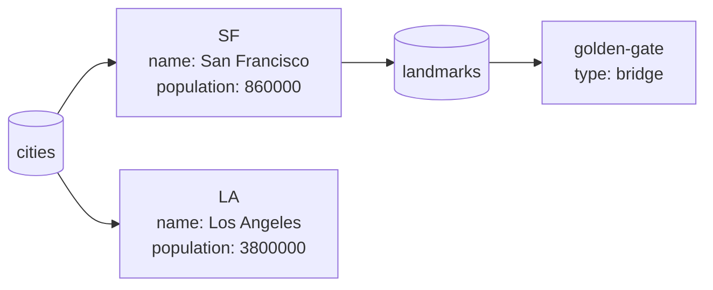

# Cloud Firestore

[Cloud Firestore](https://firebase.google.com/docs/firestore) is a NoSQL
document database: **documents** (dicts of fields) live in **collections**,
and documents can hold sub-collections. Clients read and write directly, and
can listen to changes live.

```python
from pyios_firebase.firestore import Firestore

db = Firestore.firestore()

db.collection_with_path("cities").document_with_path("LA").set_data(
    {"name": "Los Angeles", "state": "CA", "population": 3_800_000}
)
```

## Installation

1. Add the **`FirebaseFirestore`** Swift package product
   ([Installation](../getting-started/installation.md)).
2. In the Firebase console, open **Firestore Database** and create the
   database. Start in *test mode* only while developing.
3. Write [security rules](https://firebase.google.com/docs/firestore/security/get-started)
   before you ship: the client talks to the database directly, so the rules
   are what protects your data.

## The data model



| Python object | What it points to | Get it with |
|---|---|---|
| `Firestore` | The database | `Firestore.firestore()` |
| `CollectionReference` | A collection | `db.collection_with_path("cities")`, `doc.collection_with_path("landmarks")` |
| `DocumentReference` | A document (it may not exist yet) | `collection.document_with_path("SF")`, `db.document_with_path("cities/SF")`, `collection.document_with_auto_id()` |
| `Query` | Some documents of a collection, sorted and filtered | `collection.query_where_field_...(...)`, `db.collection_group_with_id("landmarks")` |
| `DocumentSnapshot` | One document as read | the callback of `get_document` or a listener |
| `QuerySnapshot` | The documents of a query, as read | the callback of `get_documents` or a listener |

References are only paths: making one reads nothing and costs nothing.
Paths alternate collection / document: `"cities/SF/landmarks/golden-gate"`.

## Guides

<div class="grid cards" markdown>

-   :material-code-json: **[Python values](data-types.md)**: what goes in and comes out, dates and times, references.
-   :material-pencil-outline: **[Writing data](writing.md)**: add, set, merge, update, delete, field values.
-   :material-magnify: **[Reading and querying](reading.md)**: get documents, filters, ordering, paging, collection groups.
-   :material-access-point: **[Realtime updates](listeners.md)**: snapshot listeners, changes, metadata, offline.
-   :material-swap-vertical: **[Transactions and batches](transactions.md)**: atomic writes, read-modify-write.
-   :material-sigma: **[Aggregation](aggregation.md)**: count, sum and average on the server.

</div>

## Use the local emulator

Point Firestore at the emulator right after `core.configure()`, before any
other Firestore call:

```python
core.configure()
Firestore.firestore().use_emulator("127.0.0.1", 8080)
```

`use_emulator` sets the host and turns TLS off (the emulator speaks plain
HTTP/2; the SDK's own `useEmulator` only sets the host). See
[Emulator Suite](../getting-started/emulators.md).

## Offline

Firestore keeps a cache on the device. Reads work offline from it; writes are
applied locally at once (listeners see them, with `has_pending_writes`) and
sent when the device is online again. A write's callback runs only when the
**server** has it, so offline it waits: do not block the UI on it.

## Errors

Firestore errors have the domain `"FIRFirestoreErrorDomain"` and the gRPC
status codes:

| `error.code` | Name | Usual cause |
|---|---|---|
| 1 | `CANCELLED` | The operation was cancelled |
| 3 | `INVALID_ARGUMENT` | A bad value or query |
| 4 | `DEADLINE_EXCEEDED` | It took too long (a slow network) |
| 5 | `NOT_FOUND` | `update_data` on a document that does not exist |
| 6 | `ALREADY_EXISTS` | Creating a document that exists |
| 7 | `PERMISSION_DENIED` | The security rules do not allow it (signed in?) |
| 8 | `RESOURCE_EXHAUSTED` | A quota was exceeded |
| 9 | `FAILED_PRECONDITION` | The query needs an index: the message has a link to create it |
| 10 | `ABORTED` | A transaction kept conflicting |
| 14 | `UNAVAILABLE` | No connection to the server (offline) |
| 16 | `UNAUTHENTICATED` | The request has no valid credentials |

Values Firestore cannot store raise `TypeError` at once, before anything is
sent ([Python values](data-types.md#values-firestore-cannot-store)).

## Limits worth knowing

| Limit | Value |
|---|---|
| Document size | 1 MiB |
| Writes in a batch or transaction | 500 |
| `in`, `not-in`, `array-contains-any` values | 30 |
| Depth of sub-collections | 100 |
| Sustained writes to one document | about 1 per second |

See the full [quotas and limits](https://firebase.google.com/docs/firestore/quotas).
