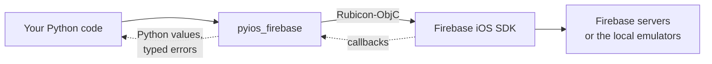

# Introduction

pyios-firebase lets a Python app on iOS use Firebase: Kivy, BeeWare, or any
other framework where [Rubicon-ObjC](https://github.com/beeware/rubicon-objc)
runs. You write Python; the library calls the official
[Firebase iOS SDK](https://github.com/firebase/firebase-ios-sdk) for you.

```python
from datetime import UTC, datetime

from pyios_firebase import core
from pyios_firebase.auth import Auth
from pyios_firebase.firestore import Firestore

core.configure()


def on_signed_in(result, error):
    if error is not None:
        print("Sign-in failed:", error.name, error.description)
        return
    uid = result.user.uid
    Firestore.firestore().document_with_path(f"users/{uid}").set_data(
        {"last_seen": datetime.now(UTC)}, merge=True
    )


Auth.auth().sign_in_anonymously(on_signed_in)
```

## How it works



The Firebase iOS SDK is the one Swift and Objective-C apps use. Your app links
it like any native app does; pyios-firebase finds its classes at runtime
through Rubicon-ObjC. In between, the library:

- **converts values both ways**: `dict`, `list`, `datetime`, `bytes`, `None`
  in, plain Python out (never `NSDictionary` or `NSNumber`);
- **keeps callback blocks alive** until Firebase calls them: a Python
  function passed to Objective-C would otherwise be freed too early, and the
  app would crash when Firebase calls it;
- **gives typed errors** (`AuthError`, `StorageError`...) with the error code
  as a name you can compare, instead of a raw `NSError`;
- **checks your input first** where the SDK would abort the whole app (an
  Objective-C exception cannot be caught from Python): a bad database path, a
  value JSON cannot carry, a trace made before Firebase is configured... You get
  a `ValueError`, `TypeError` or `RuntimeError` instead.

!!! info "No Objective-C, no Swift"
    There are no `.m`, `.h` or `.swift` files to add to your app. The only
    native work is adding the Firebase packages to the Xcode build, once
    (see [Installation](installation.md)).

## Products

| Product | Module | Firebase package | What you get |
|---|---|---|---|
| [Cloud Firestore](../firestore/index.md) | `firestore` | `FirebaseFirestore` | Documents, queries, live listeners, transactions, aggregates |
| [Authentication](../auth/index.md) | `auth` | `FirebaseAuth` | Every iOS sign-in method, multi-factor, account management |
| [Realtime Database](../database/index.md) | `database` | `FirebaseDatabase` | A live JSON tree, transactions, presence, offline |
| [Cloud Functions](../functions/index.md) | `functions` | `FirebaseFunctions` | HTTPS callable functions |
| [Cloud Storage](../storage/index.md) | `storage` | `FirebaseStorage` | Uploads, downloads, metadata, listing |
| [Remote Config](../remote-config/index.md) | `remote_config` | `FirebaseRemoteConfig` | Defaults, fetch, real-time updates, custom signals |
| [App Check](../app-check/index.md) | `app_check` | `FirebaseAppCheck` | App Attest, DeviceCheck, debug and Python providers |
| [Analytics](../analytics/index.md) | `analytics` | `FirebaseAnalytics` | Events, screen views, user properties, consent |
| [Crashlytics](../crashlytics/index.md) | `crashlytics` | `FirebaseCrashlytics` | Crashes and Python exceptions as issues |
| [Cloud Messaging](../messaging/index.md) | `messaging` | `FirebaseMessaging` | FCM tokens, topics, notifications |
| [Performance Monitoring](../performance/index.md) | `performance` | `FirebasePerformance` | Traces and HTTP metrics |
| [In-App Messaging](../in-app-messaging/index.md) | `in_app_messaging` | `FirebaseInAppMessaging-Beta` | Messages in the app: listeners, events, your own display |

Every product is its own subpackage, and importing one never loads another:
you only need the Firebase packages of the products you import.

## Requirements

- An iOS app built with Python: [Kivy](https://kivy.org) (kivy-ios or
  kivyforge), [BeeWare](https://beeware.org) (Briefcase), or similar
- Python 3.11 or newer
- [`rubicon-objc`](https://github.com/beeware/rubicon-objc) 0.5.2 or newer
  (installed with pyios-firebase)
- The Firebase iOS SDK packages of the products you use (version 13 or newer:
  the library is tested with 13.1.1)
- iOS 15 or newer, the Firebase SDK's minimum
- A Firebase project with an iOS app, and its `GoogleService-Info.plist`

## Tested on iOS

Every product runs end to end in the iOS Simulator, through the real Firebase
SDK, against the [Firebase Emulator Suite](emulators.md): about 80 tests on
each change, including a real crash found again by Crashlytics on the next
launch and a notification pushed to the Simulator. See
[Development and testing](../guides/development.md).

## Next steps

<div class="grid cards" markdown>

-   :material-download: **[Install](installation.md)**: add the library and the Firebase packages to your app.
-   :material-cog-outline: **[Set up](setup.md)**: add `GoogleService-Info.plist` and start Firebase.
-   :material-server-network: **[Use the emulators](emulators.md)**: develop against a local Firebase.
-   :material-swap-horizontal: **[Callbacks and threads](callbacks.md)**: how results come back to your code.

</div>
