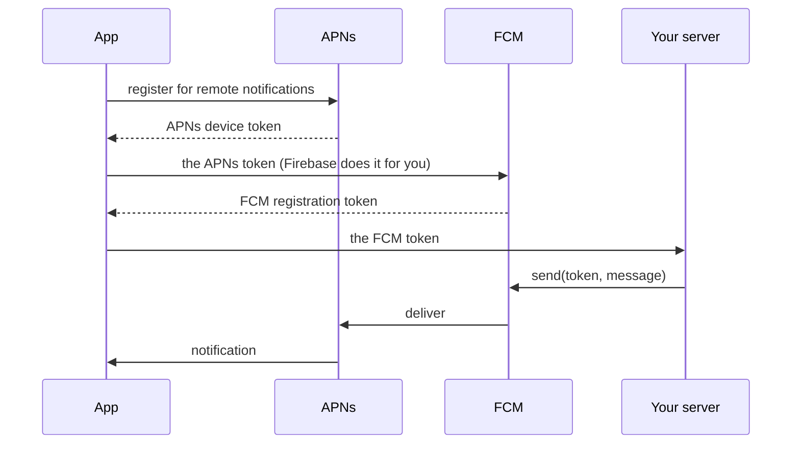

# Cloud Messaging

[Firebase Cloud Messaging](https://firebase.google.com/docs/cloud-messaging)
(FCM) sends notifications and data to the app: to one device (by its
registration token), to everyone subscribed to a **topic**, or to audiences
built in the console. On iOS, FCM delivers through Apple's push service
(APNs).

```python
from pyios_firebase.messaging import Messaging

messaging = Messaging.messaging()
messaging.add_token_listener(lambda token: send_to_my_server(token))
messaging.subscribe_to_topic("news")
```

To ask permission and handle what arrives, see
[Notifications](notifications.md).

## Installation

1. Add the **`FirebaseMessaging`** Swift package product
   ([Installation](../getting-started/installation.md)).
2. Give the app the **Push Notifications** capability
   (`aps-environment` entitlement). For background data, add **Background
   Modes > Remote notifications** too.
3. Create an **APNs authentication key** in your Apple Developer account
   (**Keys > +**, *Apple Push Notifications service*), and upload it in the
   console: **Project settings > Cloud Messaging > Apple app configuration**.
4. In the app: [ask permission and register with APNs](notifications.md#ask-permission).



!!! info "The Simulator"
    FCM cannot deliver to the iOS Simulator. `xcrun simctl push` delivers a
    test payload instead ([Notifications](notifications.md#test-on-the-simulator)).

### App configuration

What the app's build needs for this product. To combine several products, list
them all in one `products`; see [App configuration](../getting-started/configuration.md).

=== "kivyforge (pyproject.toml)"

    ```toml title="pyproject.toml"
    [[tool.kivy.ios.include_files]]
    dest = "."
    sources = ["GoogleService-Info.plist"]

    [tool.kivy.ios.native.swift_packages.Firebase]
    url = "https://github.com/firebase/firebase-ios-sdk.git"
    requirement = { from = "13.1.1" }
    products = ["FirebaseMessaging"]

    [tool.kivy.ios.xcode.build_settings]
    OTHER_LDFLAGS = "$(inherited) -ObjC"

    # Push Notifications ("production" for TestFlight and the App Store)
    [tool.kivy.ios.entitlements]
    "aps-environment" = "development"

    [tool.kivy.ios.info_plist]
    # background data with notifications
    UIBackgroundModes = ["remote-notification"]
    # optional: no token until you ask; register with the installation ID
    # FirebaseMessagingAutoInitEnabled = false
    # FirebaseMessagingInstallationIdEnabled = true

    # Kivy: the tap that launches a closed app reaches on_open (optional)
    [tool.kivy.ios.native.swift_packages.PyiosFirebaseNotificationsHook]
    url = "https://github.com/PySimpleObjC/pyios-firebase-notifications-hook.git"
    requirement = { from = "0.1.0" }
    products = ["PyiosFirebaseNotificationsHook"]
    ```

=== "Xcode (kivy-ios, Briefcase)"

    1. **File > Add Package Dependencies...**, `https://github.com/firebase/firebase-ios-sdk.git`, and pick **`FirebaseMessaging`**.
    2. **Build Settings > Other Linker Flags**: add `-ObjC`.
    3. Add `GoogleService-Info.plist` to the app target.
    4. **Signing & Capabilities**: *Push Notifications*, and *Background Modes > Remote notifications*.
    5. Optional, in **Info**: `FirebaseMessagingAutoInitEnabled` = `NO`, `FirebaseMessagingInstallationIdEnabled` = `YES`.
    6. Kivy (kivy-ios), optional: add the `https://github.com/PySimpleObjC/pyios-firebase-notifications-hook.git` package (product `PyiosFirebaseNotificationsHook`), so a tap that launches the closed app reaches `on_open` ([Notifications](notifications.md#when-the-app-is-closed)).

!!! note
    Upload an APNs authentication key in the console (**Project settings > Cloud Messaging**).

!!! tip "Kivy: taps that launch the app"
    Without the `PyiosFirebaseNotificationsHook` package, a Kivy app still
    opens when a notification is tapped while it is closed, but `on_open` does
    not get that tap. See [When the app is closed](notifications.md#when-the-app-is-closed).


## The registration token

The **FCM registration token** identifies this app install. Send it to your
server, which sends messages to it with the Admin SDK.

```python
def on_token(token):
    save_token_for(Auth.auth().current_user.uid, token)


remove = messaging.add_token_listener(on_token)     # at start-up, and on every change
```

The listener runs when the token is made (at start-up, once the APNs token is
known) and whenever it changes: after a restore to a new device, a reinstall,
or `delete_token`. Keep the server's copy up to date from it.

```python
messaging.token(lambda token, error: print(token or error.description))   # ask now
messaging.fcm_token                                                       # the current one, or None
messaging.delete_token(lambda error: ...)                                 # stop getting messages
```

=== "Server (Python, Admin SDK)"

    ```python
    from firebase_admin import messaging

    messaging.send(messaging.Message(
        token=registration_token,
        notification=messaging.Notification(title="Your order shipped", body="Arriving Tuesday"),
        data={"screen": "orders", "order_id": "42"},
    ))
    ```

### Auto-init

The token is made at start-up by default. To wait for the user's consent:
`FirebaseMessagingAutoInitEnabled` = `NO` in `Info.plist`, then
`messaging.auto_init_enabled = True` when they agree (kept across launches).

## Topics

```python
messaging.subscribe_to_topic("news", lambda error: print("Subscribed" if error is None else error.name))
messaging.unsubscribe_from_topic("news")
```

Topic names are 1 to 900 letters, digits and `- _ . ~ %`; an invalid one
raises `ValueError`. Subscribing needs the token, so it waits until FCM has
one. Send to a topic from the server: `messaging.Message(topic="news", ...)`.

## The APNs token

Firebase forwards the APNs token to FCM by itself (app delegate swizzling).
With `FirebaseAppDelegateProxyEnabled` = `NO`, set it yourself:

```python
from pyios_firebase.messaging import APNSTokenType

messaging.apns_token = device_token                         # bytes
messaging.set_apns_token(device_token, APNSTokenType.PROD)  # with its environment
```

## Registration with the installation ID

A newer mode: the app registers with FCM through its **Firebase installation
ID** instead of a token. Turn it on with
`FirebaseMessagingInstallationIdEnabled` = `YES` in `Info.plist`; the token
methods then fail, and you use:

```python
messaging.installation_id_enabled                                   # True
messaging.add_registration_listener(lambda fid: send_to_my_server(fid))
messaging.register(lambda error: ...)
messaging.unregister(lambda error: ...)
messaging.add_unregistration_listener(lambda fid: tell_my_server(fid))
```

## Several senders

To get messages from another Firebase project too:

```python
messaging.retrieve_fcm_token("other-sender-id", lambda token, error: ...)
messaging.delete_fcm_token("other-sender-id")
```

## Delete everything

```python
messaging.delete_data(lambda error: ...)        # registrations, here and on the server
```

The installation ID stays; turn auto-init off so nothing is registered again
at the next start-up.

## Errors

Errors are `MessagingError`s (`name` from `MessagingErrorCode`):

| `MessagingErrorCode` | Means |
|---|---|
| `NETWORK` | No network |
| `TIMEOUT` | The server took too long |
| `AUTHENTICATION` | The project rejected the app (check `GoogleService-Info.plist` and the API key) |
| `INVALID_REQUEST` | A bad request (for example no APNs token yet on a device) |
| `INVALID_TOPIC_NAME` | Not a valid topic |
| `OPERATION_IN_PROGRESS` | The same operation is already running |
