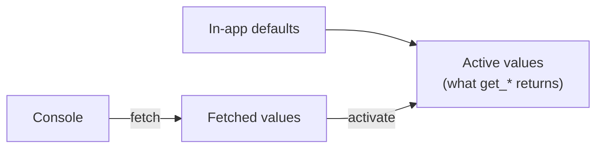

# Remote Config

[Remote Config](https://firebase.google.com/docs/remote-config) changes how
the app looks and behaves without an App Store update: you publish values in
the console, and the app reads them, with in-app defaults until the first
fetch. Conditions target values by country, app version, user property,
percentage of users (rollouts and A/B tests), or your own custom signals.

```python
from pyios_firebase.remote_config import RemoteConfig

config = RemoteConfig.setup(defaults_plist="RemoteConfigDefaults", minimum_fetch_interval=3600)

if config.get_boolean("new_checkout"):
    show_new_checkout()
title.text = config.get_string("welcome_message")
```

## Installation

Add the **`FirebaseRemoteConfig`** Swift package product
([Installation](../getting-started/installation.md)). Remote Config uses
Firebase Installations, which needs the real API key from
`GoogleService-Info.plist`.

### App configuration

What the app's build needs for this product. To combine several products, list
them all in one `products`; see [App configuration](../getting-started/configuration.md).

=== "kivyforge (pyproject.toml)"

    ```toml title="pyproject.toml"
    [[tool.kivy.ios.include_files]]
    dest = "."
    sources = ["GoogleService-Info.plist"]

    [tool.kivy.ios.native.swift_packages.Firebase]
    url = "https://github.com/firebase/firebase-ios-sdk.git"
    requirement = { from = "13.1.1" }
    products = ["FirebaseRemoteConfig"]

    [tool.kivy.ios.xcode.build_settings]
    OTHER_LDFLAGS = "$(inherited) -ObjC"

    # in-app defaults, read with defaults_plist="RemoteConfigDefaults"
    [[tool.kivy.ios.include_files]]
    dest = "."
    sources = ["RemoteConfigDefaults.plist"]
    ```

=== "Xcode (kivy-ios, Briefcase)"

    1. **File > Add Package Dependencies...**, `https://github.com/firebase/firebase-ios-sdk.git`, and pick **`FirebaseRemoteConfig`**.
    2. **Build Settings > Other Linker Flags**: add `-ObjC`.
    3. Add `GoogleService-Info.plist` to the app target.
    4. Add `RemoteConfigDefaults.plist` to the app target (if you use a defaults plist).


## How values flow



The app always reads the **active** values. Fetching downloads new values
without changing what the app sees; **activating** makes them active. That
split lets you choose when the UI changes (at the next launch, or at once).

## Set up

`setup` installs the defaults, then fetches and activates in the background:

```python
config = RemoteConfig.setup(
    defaults={"welcome_message": "Welcome", "max_items": 25},     # in code
    defaults_plist="RemoteConfigDefaults",                         # RemoteConfigDefaults.plist in the app
    defaults_file="remote_config_defaults.xml",                    # Android-format XML
    minimum_fetch_interval=3600,
    callback=lambda status, error: print("Remote Config:", status),
)
```

When several sources set the same key: `defaults` wins, then
`defaults_file`, then `defaults_plist`.

The defaults plist is a dictionary of keys to values: add
`RemoteConfigDefaults.plist` to the app bundle (kivyforge: `include_files`).
Download it from the console (**Remote Config > ... > Download default
values**) to start from what you published.

## Read values

```python
config.get_string("welcome_message")         # "Welcome"
config.get_boolean("new_checkout")           # True for "true", "1", "yes"...
config.get_number("discount")                # 0.15
config.get_long("max_items")                 # 25
config.get_json("ui_theme")                  # a JSON string value, parsed
config.get_data("banner")                    # bytes
```

Missing keys give the type's empty value (`""`, `False`, `0`). To know where a
value came from:

```python
from pyios_firebase.remote_config import RemoteConfigSource

value = config.get_value("max_items")
value.string, value.number, value.boolean, value.json()
value.source            # REMOTE, DEFAULT or STATIC (no value at all)

config.get_value("max_items", source=RemoteConfigSource.DEFAULT)    # the default, whatever is active
config.all_keys(RemoteConfigSource.REMOTE)
config.keys_with_prefix("ui_")
```

## Fetch and activate

```python
def on_fetched(status, error):
    # "success_fetched_from_remote", "success_using_pre_fetched_data" or "error"
    if status != "error":
        refresh_screen()


config.fetch_and_activate(on_fetched)
```

Or separately, to apply new values only at the next launch:

```python
config.fetch()                     # at start-up: download for next time
config.activate()                  # at the next start-up, before reading
```

| Method | Callback |
|---|---|
| `fetch_and_activate(callback)` | `(status, error)`, `status` a `FetchStatus` string |
| `fetch(callback, expiration_duration=)` | `(RemoteConfigFetchStatus, error)` |
| `activate(callback)` | `(changed, error)`: whether any value changed |
| `ensure_initialized(callback)` | `(error)`, once the values saved on the device are loaded |

`last_fetch_time` and `last_fetch_status` tell when and how the last fetch
went.

### Throttling

Fetches are cached for `minimum_fetch_interval` seconds (12 hours by
default): fetching again sooner reuses the cache. Firebase also limits each
app to a few fetches an hour; past that, fetches fail with `THROTTLED`. Lower
the interval only while developing:

```python
config.minimum_fetch_interval = 0 if DEBUG else 3600
config.fetch_timeout = 30           # seconds
```

## Real-time updates

Published changes reach the app within seconds while it runs:

```python
def on_update(update, error):
    if error is not None:
        return
    if "welcome_message" in update.updated_keys:
        config.activate(lambda changed, error: refresh_screen())


listener = config.add_on_config_update_listener(on_update)
...
listener.remove()
```

The listener only says what changed; call `activate` to use the new values.

## Custom signals

Target conditions at your own attributes, set from the app:

```python
config.set_custom_signals({"plan": "pro", "level": 12, "beta_tester": None})   # None removes one
```

Values are `str`, `int` or `float` (not `bool`: use `"true"` / `"false"` or
`1` / `0`). In the console, add a condition **Custom signal: plan == pro**.

## Errors

| `RemoteConfigErrorCode` | Means |
|---|---|
| `THROTTLED` | Too many fetches: the cached values are still used |
| `UNKNOWN` | The fetch failed (offline, or a bad configuration) |
| `INTERNAL_ERROR` | The server failed |

A failed fetch is not fatal: the app keeps the active values (the defaults
at first). Show the defaults rather than an error.

## Development

Remote Config has no emulator. Develop with the in-app defaults, and against
a real project with `minimum_fetch_interval = 0`.

## A/B testing, personalization, rollouts

Set them up in the console. The app only reads values: nothing to change in
the code.
